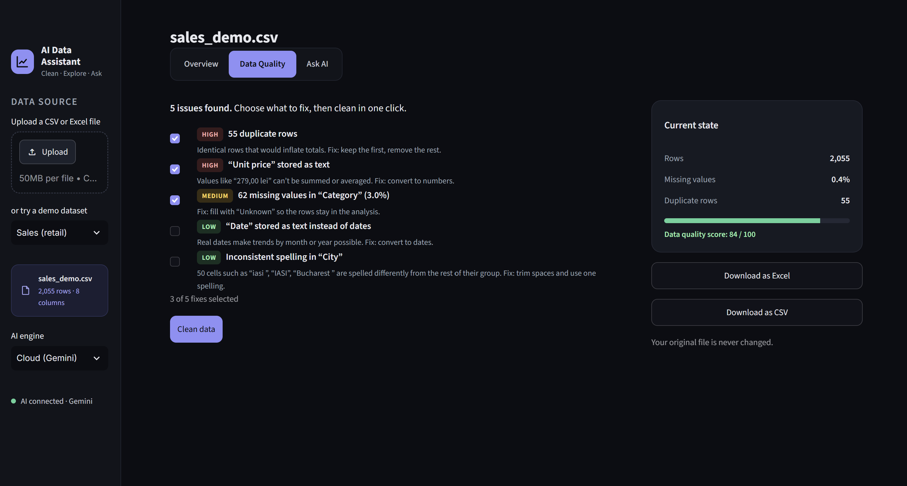
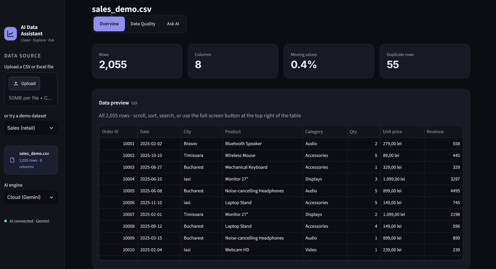
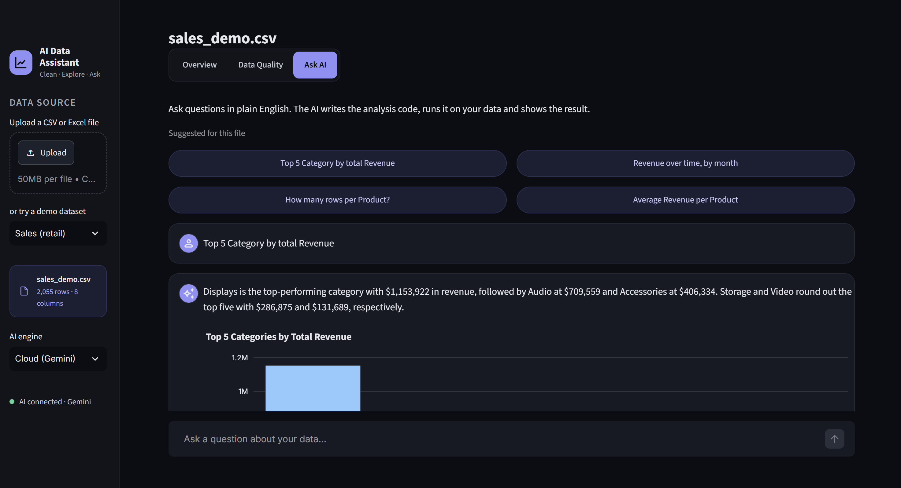

# AI Data Assistant

An AI-powered tool that **finds and fixes data quality problems** in Excel/CSV files and **answers questions about the data in plain English**, with tables and charts.

Upload a file → see what's wrong with it → clean it in one click → ask *"Which are the top 5 cities by revenue?"* and get the answer, the chart and the code that produced it.



| Overview | Ask AI |
|---|---|
|  |  |

## Features

- **Overview**: rows, columns, missing values, duplicates, a preview and the detected type of every column.
- **Data Quality** (plain pandas, no AI): detects duplicate rows, numbers stored as text (`1.099,00 lei`), dates stored as text, missing values and inconsistent spelling (`Bucharest`, `bucharest `, `BUCHAREST`). You pick the fixes, clean in one click and download the result as Excel or CSV. The original file is never changed.
- **Ask AI**: a small agent that turns a question into pandas code, runs it on the data and shows the result with a short explanation. If the code fails, the error is sent back to the model, which corrects itself (up to 3 attempts). The generated code is always shown.

## How it works

```
question ──► prompt (column names, types, 5 sample rows) ──► Gemini
                                                              │
         result + chart ◄── run code on the full table ◄── pandas code
                 │                     │
                 │                     └── error? send it back to the model and retry
                 ▼
     short explanation (second model call)
```

Only the column names and a few sample rows are sent to the model. All calculations run locally on the full file, so it works on large files and the complete data never leaves your computer.

## Project structure

```
app.py               Streamlit interface (sidebar, 3 tabs)
data_quality.py      quality checks and cleaning (no AI)
ai_agent.py          prompts, code generation, restricted execution, self-correction
assets/style.css     dark theme styling
.streamlit/config.toml  Streamlit theme colours
sample_data/         two synthetic demo datasets (sales, HR) with deliberate problems
scripts/make_demo_data.py  regenerates the demo datasets
tests/               pytest tests (the AI is replaced by a fake model)
docs/                screenshots used in this README
```

## Run it locally

Requires Python 3.10+.

```bash
git clone https://github.com/TudoseNicolas/ai-data-assistant.git
cd ai-data-assistant
python -m venv .venv
# Windows: .venv\Scripts\activate      macOS/Linux: source .venv/bin/activate
pip install -r requirements.txt
```

Create a free Gemini API key in [Google AI Studio](https://aistudio.google.com), then copy `.env.example` to `.env` and paste the key:

```
GEMINI_API_KEY=your-key-here
```

Start the app:

```bash
streamlit run app.py
```

The Overview and Data Quality tabs work without a key; only Ask AI needs it.

### Run the AI locally instead (optional)

Ask AI can also use an open-source model on your own computer through [Ollama](https://ollama.com): no API key, no usage limits, and the data never leaves the machine.

1. Install Ollama and make sure it is running.
2. Download a coding model: `ollama pull qwen2.5-coder:7b` (any model works; set `OLLAMA_MODEL` in `.env` to use another).
3. In the app sidebar, set **AI engine** to **Local (Ollama)**.

Local answers are slower than the cloud (seconds to a minute, depending on the computer), and small models make more mistakes; the self-correction loop helps with that.

## Tests

```bash
pytest
```

The tests cover number/date parsing, every quality check, cleaning, the safety checks on generated code and the agent's self-correction loop (with a fake model, so no API key is needed).

## Deploy (optional)

On [Streamlit Community Cloud](https://streamlit.io/cloud): connect the GitHub repository, choose `app.py`, and add `GEMINI_API_KEY` under **Settings → Secrets**.

## Limitations

- The model can misunderstand a question; that is why the generated code is always visible.
- Generated code runs with a restricted set of functions and is checked for imports, file access and system calls before running. This is enough for a demo, but a production system should run such code in an isolated sandbox.
- Spelling standardisation groups values that differ only in case, spaces or diacritics; it does not merge different words (e.g. "Bucharest" and "București").

## Tech stack

Python · pandas · Streamlit · Plotly · Google Gemini API (`google-genai`) · Ollama · pytest

## AI engines

`ai_agent.py` talks to models through small classes with a `generate(prompt)` method:

- `GeminiClient`: Google Gemini in the cloud. Retries when the service is busy and, if the model stays unavailable, switches automatically to another available Gemini "flash" model.
- `OllamaClient`: an open-source model running locally through Ollama.

To add another provider, write a class with the same method and offer it in `choose_engine()` in `app.py`.
